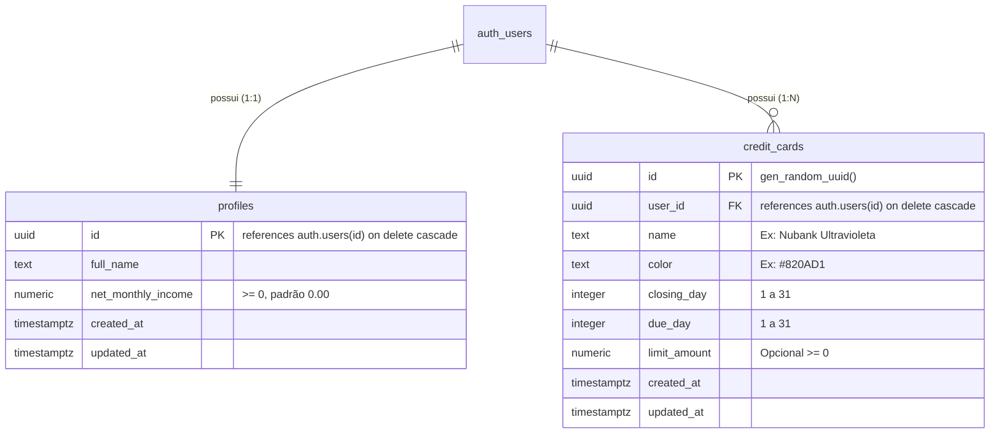

# Arquitetura e Decisões Técnicas

> Última atualização: 2026-11-22

Este documento descreve a arquitetura de software, stack tecnológica, modelo de dados e decisões estruturais do **Gestor de Assinaturas e Compromissos Financeiros**.

---

## 1. Stack Tecnológica

| Camada | Tecnologia | Motivação |
|---|---|---|
| **Framework Web** | Next.js 16 (App Router) | Renderização híbrida (Server/Client), Server Actions e Turbopack. |
| **Linguagem** | TypeScript 5 | Tipagem estrita de ponta a ponta para integridade do motor financeiro. |
| **Estilização** | Tailwind CSS v4 + shadcn/ui | Estilos atômicos rápidos, componentes acessíveis e design system consistente. |
| **Identidade Visual** | Dark Mode nativo + Roboto | Paleta noturna (Slate/Grafite `#090D16` e `#0F172A`) com acentos em Esmeralda (`#10B981`). |
| **Animações** | Framer Motion | Micro-interações e transições fluidas de estado. |
| **Validação** | Zod + React Hook Form | Validação declarativa de esquemas tanto no cliente quanto nas Server Actions. |
| **Banco de Dados & Auth** | Supabase (PostgreSQL 15+) | Autenticação gerenciada, RLS multi-tenant e triggers nativos. |
| **Integração Auth** | `@supabase/ssr` | Manipulação segura de cookies e sessões no App Router e Middleware. |

---

## 2. Estrutura de Pastas

```text
gestor-despesas/
├── docs/                      # Documentação de arquitetura, visão geral, PRD e planos de fases
├── src/
│   ├── app/                   # Next.js App Router
│   │   ├── (auth)/            # Rotas públicas: /login e /register
│   │   ├── (dashboard)/       # Rotas autenticadas sob layout com Header comum
│   │   │   ├── dashboard/     # Tela inicial com métricas, resumo e onboarding de renda
│   │   │   ├── cards/         # Gestão de cartões de crédito e ciclos de fatura
│   │   │   └── settings/      # Configuração de perfil e renda líquida
│   │   ├── actions/           # Server Actions (auth.ts, cards.ts)
│   │   ├── auth/callback/     # Troca de código de autorização OAuth/Email
│   │   └── layout.tsx         # Root Layout com fontes (Roboto) e Toaster
│   ├── components/            # Componentes organizados por domínio
│   │   ├── auth/              # Formulários de login e cadastro
│   │   ├── cards/             # CardItem, CardFormDialog e DeleteCardDialog
│   │   ├── dashboard/         # Header global, IncomeOnboardingModal e SettingsForm
│   │   └── ui/                # Primitivos shadcn/ui (button, input, card, dialog, etc.)
│   ├── lib/
│   │   ├── supabase/          # Clientes client.ts (Browser), server.ts (SSR) e middleware.ts
│   │   └── utils.ts           # Formatadores monetários BRL e utilitário cn()
│   ├── schemas/               # Schemas Zod de validação (auth.ts, cards.ts)
│   └── middleware.ts          # Proteção de rotas e renovação de JWT de sessão
└── supabase/
    └── migrations/            # Arquivos SQL versionados com DDL, RLS e triggers
```

---

## 3. Modelo de Dados e Isolamento (RLS)

O isolamento de dados é garantido na camada de banco de dados (Row Level Security) via `(select auth.uid())`, assegurando que usuários acessem apenas seus próprios registros.



### Regras de Banco Implementadas:
- **Trigger `on_auth_user_created`:** Provisiona automaticamente uma linha em `public.profiles` quando um usuário é criado em `auth.users`.
- **Trigger `handle_updated_at`:** Atualiza o campo `updated_at` automaticamente antes de cada `UPDATE` em `profiles` e `credit_cards`.
- **Índices de Performance:** `idx_credit_cards_user_id` em `credit_cards(user_id)`.

---

## 4. Regras de Negócio e Decisões de Arquitetura

### 4.1. Proteção de Rotas & Sessão SSR
- O arquivo `middleware.ts` intercepta requisições e executa `supabase.auth.getUser()`.
- Rotas protegidas (`/dashboard`, `/cards`, `/settings`, `/commitments`, `/projection`) redirecionam para `/login` se a sessão for inválida.
- Rotas de autenticação (`/login`, `/register`) redirecionam para `/dashboard` se o usuário já estiver autenticado.
- A rota raiz `/` atua como roteador condicional (usuário autenticado vai para `/dashboard`; anônimo vai para `/login`).

### 4.2. Ciclo de Faturamento de Cartões (Regra 2 do PRD)
- O sistema armazena `closing_day` e `due_day`.
- Quando `due_day <= closing_day`, a interface sinaliza que o vencimento financeiro ocorre no mês subsequente à data de fechamento, preparando a base matemática para o motor de projeção de 12 meses (Fase 4).

### 4.3. Server Components vs Client Components
- Páginas buscam dados diretamente no servidor usando `createClient()` de `src/lib/supabase/server.ts` (sem passar callbacks para client components).
- Mutações ocorrem via **Server Actions** em `src/app/actions/`, validando inputs com Zod e retornando payloads tipados `{ success, error, data }`.
