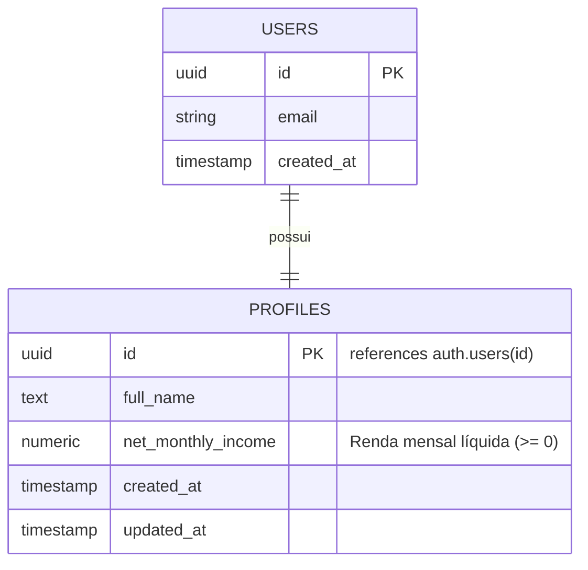

# Plano de Implementação — Fase 1: Fundação, Autenticação e Perfil de Renda

## Visão Geral & Contexto
Conforme estabelecido no [PRD](../prd/gestor-compromissos-financeiros.md), o **Gestor de Assinaturas e Compromissos Financeiros** tem como propósito a previsibilidade financeira de caixa futuro para os próximos 12 meses.

A **Fase 1 (Spec 01)** estabelece a espinha dorsal de todo o sistema:
1. Setup inicial do projeto na stack oficial (**Next.js 16 App Router, TypeScript, Tailwind CSS v4, shadcn/ui, Framer Motion, Supabase**).
2. Modelagem do banco relacional PostgreSQL com isolamento multi-tenant via **Row-Level Security (RLS)** nativo (`auth.uid() = user_id`).
3. Fluxo completo de autenticação (Cadastro, Login, Logout e recuperação de sessão no SSR/Client).
4. Gerenciamento do **Perfil Financeiro** do usuário, com destaque para a **Renda Mensal Líquida** (parâmetro basilar de todas as métricas percentuais de comprometimento das fases futuras) e diálogo/onboarding de primeiro acesso.

---

## User Review Required
> [!IMPORTANT]
> **Atenção aos comandos no Windows / PowerShell:**
> - A política de execução do PowerShell bloqueia a execução direta de `npm.ps1`. Todos os comandos de build e instalação devem ser executados via `cmd.exe /c "npm.cmd ..."` ou `npx.cmd`.
> - As credenciais do Supabase (`NEXT_PUBLIC_SUPABASE_URL` e `NEXT_PUBLIC_SUPABASE_ANON_KEY`) deverão ser configuradas no arquivo `.env.local`. Já identificamos a URL do seu projeto no MCP (`project_ref = kghazqzvrrkftarrqzxd`).

> [!NOTE]
> **Design & Identidade Visual:**
> Seguindo as diretrizes de design de alto padrão (sem visual genérico de template de IA), adotaremos uma paleta financeira limpa e moderna: tons profundos de grafite/slate (`#0F172A`, `#1E293B`), superfícies nítidas com contraste tipográfico refinado (Inter / Plus Jakarta Sans) e acentos em esmeralda/menta para liquidez e status positivo, com feedback visual fluido via Framer Motion.

---

## Arquitetura de Dados (PostgreSQL + RLS)

Seguindo as diretrizes da skill `supabase-postgres-best-practices`:
- Toda tabela contém `user_id uuid not null references auth.users(id) on delete cascade`.
- RLS habilitado imediatamente com `alter table profiles enable row level security`.
- Políticas separadas e otimizadas: uso explícito de `(select auth.uid())` para evitar reavaliação de subquery a cada linha.
- Trigger automático em `auth.users` para provisionar o registro em `profiles` logo no signup.



---

## Proposta de Mudanças

```
gestor-despesas/
├── .env.example                        [NEW] Exemplo de variáveis de ambiente do Supabase
├── package.json                        [NEW] Manifesto com scripts e dependências da stack
├── tsconfig.json                       [NEW] Configurações TypeScript estritas
├── tailwind.config.ts                  [NEW] Configuração de design tokens e Tailwind
├── components.json                     [NEW] Configuração do shadcn/ui
├── supabase/
│   └── migrations/
│       └── 20261120000000_init_profiles.sql [NEW] DDL de profiles, triggers e RLS
├── src/
│   ├── app/
│   │   ├── (auth)/
│   │   │   ├── login/page.tsx          [NEW] Tela de login
│   │   │   └── register/page.tsx       [NEW] Tela de cadastro com validação
│   │   ├── (dashboard)/
│   │   │   ├── layout.tsx              [NEW] Layout protegido com verificação de sessão e header
│   │   │   ├── page.tsx                [NEW] Visão geral inicial com onboarding de renda
│   │   │   └── settings/page.tsx       [NEW] Configuração de perfil e atualização da renda
│   │   ├── auth/callback/route.ts      [NEW] Rota de troca de token de auth
│   │   ├── layout.tsx                  [NEW] Root layout com fontes e providers
│   │   └── globals.css                 [NEW] Variáveis de tema e estilos base
│   ├── components/
│   │   ├── auth/
│   │   │   ├── login-form.tsx          [NEW] Formulário de login (React Hook Form + Zod)
│   │   │   └── register-form.tsx       [NEW] Formulário de registro
│   │   ├── dashboard/
│   │   │   ├── header.tsx              [NEW] Barra superior com avatar, renda atual e logout
│   │   │   └── income-onboarding-modal.tsx [NEW] Modal/Dialog que orienta o cadastro da renda
│   │   └── ui/                         [NEW] Componentes base shadcn (button, input, card, dialog, etc.)
│   ├── lib/
│   │   ├── supabase/
│   │   │   ├── client.ts               [NEW] Client-side Supabase client (Browser)
│   │   │   ├── server.ts               [NEW] Server-side Supabase client (SSR / Server Actions)
│   │   │   └── middleware.ts           [NEW] Middleware helper para refresh de sessão
│   │   └── utils.ts                    [NEW] Helpers (formatação de moeda BRL, cn, etc.)
│   ├── schemas/
│   │   └── auth.ts                     [NEW] Validações Zod para login, registro e renda
│   └── middleware.ts                   [NEW] Proteção de rotas autenticadas
```

---

## Detalhamento dos Componentes e Etapas

### 1. Inicialização do Projeto & Dependências
- Inicializar Next.js 16 (App Router, TypeScript, Tailwind, ESLint, alias `@/*`).
- Instalar dependências essenciais:
  - `@supabase/ssr` e `@supabase/supabase-js`
  - `lucide-react`, `clsx`, `tailwind-merge`
  - `framer-motion`
  - `zod`, `react-hook-form`, `@hookform/resolvers`
  - Componentes essenciais shadcn (`button`, `input`, `label`, `card`, `dialog`, `dropdown-menu`, `toast/sonner`).

### 2. Banco de Dados & Migração Supabase
Criar a migration SQL com boas práticas:
```sql
-- Criação da tabela de perfis atrelada ao auth.users
create table public.profiles (
  id uuid primary key references auth.users(id) on delete cascade,
  full_name text,
  net_monthly_income numeric(12, 2) not null default 0.00 check (net_monthly_income >= 0),
  created_at timestamptz not null default now(),
  updated_at timestamptz not null default now()
);

-- Ativar RLS
alter table public.profiles enable row level security;

-- Políticas de RLS com otimização (select auth.uid())
create policy "Usuários podem visualizar o próprio perfil"
  on public.profiles for select
  to authenticated
  using (id = (select auth.uid()));

create policy "Usuários podem atualizar o próprio perfil"
  on public.profiles for update
  to authenticated
  using (id = (select auth.uid()))
  with check (id = (select auth.uid()));

-- Trigger para criar perfil automaticamente após cadastro no Auth
create or replace function public.handle_new_user()
returns trigger language plpgsql security definer as $$
begin
  insert into public.profiles (id, full_name, net_monthly_income)
  values (new.id, new.raw_user_meta_data->>'full_name', 0.00);
  return new;
end;
$$;

create trigger on_auth_user_created
  after insert on auth.users
  for each row execute function public.handle_new_user();
```

### 3. Autenticação e Proteção de Rotas (SSR + Middleware)
- Criação dos clientes Supabase com `@supabase/ssr` (garantindo compatibilidade com Server Components e Server Actions).
- Implementação de `middleware.ts` para redirecionamento:
  - Se usuário **não autenticado** tentar acessar `/dashboard` ou `/settings` $\rightarrow$ redireciona para `/login`.
  - Se usuário **autenticado** tentar acessar `/login` ou `/register` $\rightarrow$ redireciona para `/dashboard`.

### 4. Fluxo de Onboarding de Renda & Gestão de Perfil
- **Diálogo de Boas-vindas:** Quando o usuário loga e seu `net_monthly_income == 0`, é exibido um modal elegante orientando: *"Para calcularmos a taxa de comprometimento dos seus gastos, qual é a sua renda mensal líquida aproximada?"*.
- **Máscara & Formatação BRL:** Input monetário com suporte a digitação fluida em reais (`R$ 5.000,00`).
- **Página de Configurações:** Permite alterar o valor a qualquer momento, atualizando o cabeçalho e preparando o terreno para os cálculos da Fase 4.

---

## Plano de Verificação

### Testes Automatizados
- Execução de build estático do Next.js sem erros de tipo:
  ```cmd
  cmd.exe /c "npm.cmd run build"
  ```
- Linting e checagem de tipos TypeScript:
  ```cmd
  cmd.exe /c "npx.cmd tsc --noEmit"
  ```

### Verificação Manual
1. **Fluxo de Registro:**
   - Criar uma nova conta com e-mail e senha.
   - Verificar se o usuário foi autenticado com sucesso e direcionado para a tela principal.
2. **Onboarding de Renda Líquida:**
   - Ao acessar pela primeira vez, conferir abertura do diálogo solicitando a renda líquida.
   - Salvar o valor (ex: `R$ 4.500,00`) e conferir se foi salvo no perfil do Supabase e refletido no topo da página.
3. **Edição de Perfil:**
   - Acessar `/settings`, alterar a renda para `R$ 6.000,00`, salvar e verificar se persiste após recarregar a página.
4. **Proteção de Rotas:**
   - Efetuar logout e tentar acessar `/dashboard` diretamente via URL para conferir redirecionamento imediato para `/login`.
