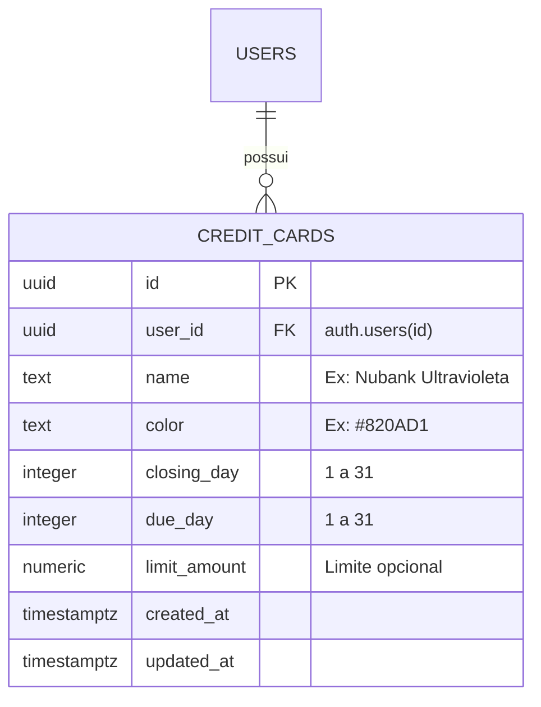

# Plano de Implementação — Fase 2: Meios de Pagamento e Gestão de Cartões de Crédito

## Visão Geral & Contexto
Conforme a [Spec 02 do PRD](../prd/gestor-compromissos-financeiros.md#L237-L279), a **Fase 2** estabelece a entidade essencial de **Cartões de Crédito** com seus respectivos ciclos de fatura (**dia de fechamento** vs. **dia de vencimento**).

Esta estrutura é o alicerce matemático da **Regra de Ouro (Regra 2 do PRD)**:
> *"Se um compromisso está vinculado a um cartão de crédito e sua data de cobrança for superior ao dia de fechamento daquele cartão, o impacto financeiro (desembolso) será contabilizado no mês de vencimento da fatura subsequente."*

---

## User Review Required
> [!IMPORTANT]
> **Regra de Virada de Mês no Vencimento:**
> Se o `due_day` (dia de vencimento) for menor ou igual ao `closing_day` (dia de fechamento), convencionalmente a fatura vence no **mês calendário seguinte** ao fechamento (exemplo clássico: cartão fecha dia 25 de janeiro e vence dia 5 de fevereiro). O sistema tratará essa regra de forma explícita na UI e no motor de projeção.

> [!NOTE]
> **Visual dos Cartões:**
> Criaremos cards interativos inspirados em cartões físicos reais (com suporte a paleta de cores/temas selecionáveis pelo usuário: Nubank Roxo, Inter Laranja, Black Grafite, Emerald, Blue, etc., bandeira/nome e chips visuais), mantendo o tema escuro elegante com a fonte Roboto.

---

## Arquitetura de Dados (PostgreSQL + RLS)

Seguindo as diretrizes da skill `supabase-postgres-best-practices`:
- Tabela `public.credit_cards` com chave estrangeira `user_id uuid not null references auth.users(id) on delete cascade`.
- Validações em nível de banco: `closing_day between 1 and 31`, `due_day between 1 and 31`, `limit_amount >= 0`.
- RLS rigoroso com políticas isoladas e otimizadas com `(select auth.uid())` para `SELECT`, `INSERT`, `UPDATE` e `DELETE`.
- Índices para performance: `create index idx_credit_cards_user_id on public.credit_cards(user_id)`.



---

## Proposta de Mudanças

```
gestor-despesas/
├── supabase/
│   └── migrations/
│       └── 20261120000001_create_credit_cards.sql [NEW] DDL da tabela credit_cards, RLS e índices
├── src/
│   ├── app/
│   │   ├── (dashboard)/
│   │   │   └── cards/
│   │   │       ├── page.tsx                       [NEW] Página de listagem e gerenciamento de cartões
│   │   │       └── loading.tsx                    [NEW] Skeleton de carregamento dos cartões
│   │   └── actions/
│   │       └── cards.ts                           [NEW] Server Actions para CRUD de cartões
│   ├── components/
│   │   ├── cards/
│   │   │   ├── card-item.tsx                      [NEW] Representação visual do cartão (estilo cartão físico)
│   │   │   ├── card-form-dialog.tsx               [NEW] Modal de criação e edição com seletor de cores e ciclo
│   │   │   └── delete-card-dialog.tsx             [NEW] Modal de confirmação segura de exclusão
│   │   └── ui/
│   │       └── alert-dialog.tsx                   [NEW] Componente shadcn para diálogos destrutivos
│   └── schemas/
│       └── cards.ts                               [NEW] Schema Zod de validação de cartões
```

---

## Detalhamento dos Componentes e Etapas

### 1. Migração Supabase (`20261120000001_create_credit_cards.sql`)
```sql
create table if not exists public.credit_cards (
  id uuid primary key default gen_random_uuid(),
  user_id uuid not null references auth.users(id) on delete cascade,
  name text not null,
  color text not null default '#10b981',
  closing_day integer not null check (closing_day between 1 and 31),
  due_day integer not null check (due_day between 1 and 31),
  limit_amount numeric(12, 2) check (limit_amount is null or limit_amount >= 0),
  created_at timestamptz not null default now(),
  updated_at timestamptz not null default now()
);

-- Ativar RLS
alter table public.credit_cards enable row level security;

-- Políticas de isolamento RLS
create policy "Usuários podem visualizar seus próprios cartões"
  on public.credit_cards for select
  to authenticated
  using (user_id = (select auth.uid()));

create policy "Usuários podem criar seus próprios cartões"
  on public.credit_cards for insert
  to authenticated
  with check (user_id = (select auth.uid()));

create policy "Usuários podem atualizar seus próprios cartões"
  on public.credit_cards for update
  to authenticated
  using (user_id = (select auth.uid()))
  with check (user_id = (select auth.uid()));

create policy "Usuários podem excluir seus próprios cartões"
  on public.credit_cards for delete
  to authenticated
  using (user_id = (select auth.uid()));

-- Índice para consultas rápidas por usuário
create index if not exists idx_credit_cards_user_id on public.credit_cards(user_id);

-- Trigger de updated_at
create trigger on_credit_cards_updated_at
  before update on public.credit_cards
  for each row execute function public.handle_updated_at();
```

### 2. Validação Zod (`src/schemas/cards.ts`)
- `name`: 2 a 40 caracteres, obrigatório.
- `closingDay`: inteiro de 1 a 31.
- `dueDay`: inteiro de 1 a 31.
- `color`: string hexadecimal (#RRGGBB).
- `limitAmount`: numérico opcional $\ge 0$.

### 3. Server Actions (`src/app/actions/cards.ts`)
- `createCreditCardAction`: criação com vínculo direto em `auth.uid()`.
- `updateCreditCardAction`: edição com verificação de posse.
- `deleteCreditCardAction`: exclusão protegida.

### 4. Interface de Usuário
- **Listagem `/cards`:**
  - Grade responsiva com cartões cadastrados ou estado vazio convidativo com ilustração e CTA *"Adicionar seu primeiro cartão"*.
  - Indicadores claros do ciclo de fatura: *"Fecha dia X · Vence dia Y"* com badge explicativo quando o vencimento cai no mês seguinte.
- **Modal de Formulário:**
  - Campo de nome com sugestões rápidas (Nubank, Itaú, Inter, Bradesco, C6, XP, Santander).
  - Paleta com 8 temas/cores pré-definidos (Roxo Nubank, Laranja Inter, Preto Black, Esmeralda, Azul Royal, Grafite, etc.) + preview em tempo real.
  - Seletores intuitivos para dia de fechamento e dia de vencimento.
- **Atualização do Dashboard:**
  - Atualizar o card de "Cartões de Crédito" no `/dashboard` para refletir o total real de cartões cadastrados.

---

## Plano de Verificação

### Testes Automatizados
- Validação estática de tipos e build do Next.js:
  ```cmd
  cmd.exe /c "npx.cmd tsc --noEmit && npm.cmd run build"
  ```

### Verificação Manual
1. **Cadastro de Cartão:**
   - Cadastrar um cartão "Nubank" (fechamento dia 20, vencimento dia 27, cor roxa).
   - Verificar se o cartão aparece renderizado com seu tema e ciclo.
2. **Ciclo de Virada de Mês:**
   - Cadastrar um cartão com fechamento dia 25 e vencimento dia 05.
   - Confirmar se o badge exibe o indicativo *"Vence no mês seguinte"*.
3. **Edição:**
   - Alterar o nome ou dias de fechamento/vencimento e validar atualização imediata.
4. **Exclusão:**
   - Excluir o cartão e conferir remoção do grid e retorno ao estado vazio se não houver outros.
5. **Dashboard Sync:**
   - Conferir se o contador no `/dashboard` reflete a quantidade exata de cartões.
