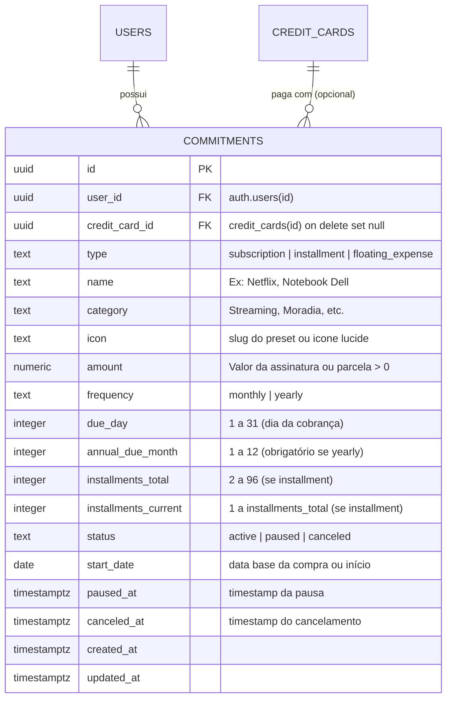

# Plano de Implementação — Fase 3: Gestão de Compromissos Financeiros

## Visão Geral & Contexto
Conforme detalhado no [PRD (Specs 03, 04 e 05)](../prd/gestor-compromissos-financeiros.md#L282-L418), a **Fase 3** implementa o coração de entrada e gerenciamento de dados do **Gestor de Compromissos Financeiros**.

Esta fase viabiliza o cadastro ágil e o ciclo de vida completo de todos os compromissos que alimentarão o motor de projeção de 12 meses (Fase 4) e o checklist de pagamentos (Fase 5):
1. **Spec 03 — Catálogo de Presets e Assinaturas Fixas:** Catálogo interativo de serviços populares (Netflix, Spotify, Prime, Disney+, etc.) para onboarding instantâneo, mais suporte a assinaturas personalizadas mensais e anuais.
2. **Spec 04 — Compras Parceladas e Despesas Flutuantes:** Registro de compras em parcelas com contagem regressiva e data prevista de quitação, e despesas fixas variáveis (luz, água, internet) tratadas por valor médio estimado.
3. **Spec 05 — Gestão do Ciclo de Vida:** Central completa de compromissos (`/commitments`) com edição, pausa temporária, cancelamento, exclusão física e filtros dinâmicos por status, categoria e cartão de crédito.

---

## User Review Required
> [!IMPORTANT]
> **Modelo Unificado vs. Múltiplas Tabelas:**
> Adotaremos uma tabela única e polimórfica `public.commitments` com a coluna `type text not null check (type in ('subscription', 'installment', 'floating_expense'))`. Isso simplifica drasticamente consultas do motor de projeção (Fase 4) e do checklist mensal (Fase 5), garante transações atômicas e simplifica a reatividade em tela, mantendo regras de validação estritas via constraints de banco e schemas Zod.

> [!NOTE]
> **Vínculo com Cartões de Crédito e Integridade Referencial:**
> A coluna `credit_card_id` referencia `public.credit_cards(id) on delete set null`. Adicionalmente, implementaremos na Server Action de exclusão de cartão a validação da **Regra da Spec 02**: impedir a exclusão de um cartão que possua compromissos ativos vinculados, orientando o usuário a reatribuí-los antes da exclusão.

> [!TIP]
> **Presets Populares Nativos:**
> O catálogo de presets será estruturado como uma biblioteca declarativa e extensível no frontend (`src/lib/presets.ts`), contendo metadados (nome, categoria, slug, ícone, cor tema e planos comuns de valores em BRL), permitindo preenchimento instantâneo com 1 clique sem requisições adicionais ao banco.

---

## Arquitetura de Dados (PostgreSQL + RLS)

Seguindo as diretrizes da skill `supabase-postgres-best-practices`:
- Tabela `public.commitments` com chave estrangeira `user_id uuid not null references auth.users(id) on delete cascade`.
- Validações estritas em nível de banco para tipos, frequências, valores positivos e coerência de parcelamento (`installments_current <= installments_total`).
- Isolamento total por usuário através de políticas RLS otimizadas com `(select auth.uid())`.
- Índices estratégicos para listagens por usuário, status e cartões vinculados.



---

## Proposta de Mudanças

```
gestor-despesas/
├── docs/
│   └── plans/
│       └── fase-3-gestao-compromissos.md          [NEW] Este plano de implementação
├── supabase/
│   └── migrations/
│       └── 20261120000002_create_commitments.sql [NEW] DDL da tabela commitments, constraints, RLS e índices
├── src/
│   ├── app/
│   │   ├── (dashboard)/
│   │   │   ├── commitments/
│   │   │   │   ├── page.tsx                      [NEW] Página principal de gestão de compromissos
│   │   │   │   └── loading.tsx                   [NEW] Skeleton de carregamento
│   │   │   └── dashboard/
│   │   │       └── page.tsx                      [MODIFIED] Refletir contadores reais de compromissos e custos
│   │   └── actions/
│   │       ├── commitments.ts                    [NEW] Server Actions para CRUD e ciclo de vida
│   │       └── cards.ts                          [MODIFIED] Bloquear exclusão se existirem compromissos ativos
│   ├── components/
│   │   ├── dashboard/
│   │   │   └── header.tsx                        [MODIFIED] Adicionar item 'Compromissos' na navegação
│   │   ├── commitments/
│   │   │   ├── commitments-client-view.tsx       [NEW] Visão com abas, busca, filtros e cards
│   │   │   ├── commitment-card.tsx               [NEW] Card visual com badges de status, cartão e parcelas
│   │   │   ├── commitment-form-dialog.tsx        [NEW] Modal polimórfico (Tabs: Presets, Parcelas, Variável)
│   │   │   ├── preset-catalog-grid.tsx           [NEW] Grade interativa de seleção de presets
│   │   │   ├── status-change-dialog.tsx          [NEW] Modal de confirmação de pausa/cancelamento
│   │   │   └── delete-commitment-dialog.tsx      [NEW] Confirmação destrutiva de exclusão
│   │   └── ui/
│   │       ├── tabs.tsx                          [NEW] Componente shadcn/ui Tabs
│   │       └── select.tsx                        [NEW] Componente shadcn/ui Select (caso necessário)
│   ├── lib/
│   │   ├── presets.ts                            [NEW] Catálogo de presets populares com cores e categorias
│   │   └── utils.ts                              [MODIFIED] Helpers de cálculo de parcelas restantes e datas
│   └── schemas/
│       └── commitments.ts                        [NEW] Schemas Zod polimórficos de validação
```

---

## Detalhamento dos Componentes e Etapas

### 1. Migração Supabase (`20261120000002_create_commitments.sql`)

```sql
-- Migration: 20261120000002_create_commitments.sql
-- Description: Criação da tabela commitments para assinaturas, parcelamentos e contas flutuantes com RLS

create table if not exists public.commitments (
  id uuid primary key default gen_random_uuid(),
  user_id uuid not null references auth.users(id) on delete cascade,
  credit_card_id uuid references public.credit_cards(id) on delete set null,
  
  -- Identificação e categorização
  type text not null check (type in ('subscription', 'installment', 'floating_expense')),
  name text not null,
  category text not null default 'Outros',
  icon text default 'wallet',
  
  -- Valores e cobrança
  amount numeric(12, 2) not null check (amount > 0),
  frequency text not null default 'monthly' check (frequency in ('monthly', 'yearly')),
  due_day integer not null check (due_day between 1 and 31),
  annual_due_month integer check (annual_due_month is null or (annual_due_month between 1 and 12)),
  
  -- Controle de parcelas (para installment)
  installments_total integer check (installments_total is null or (installments_total between 2 and 96)),
  installments_current integer check (installments_current is null or (installments_current between 1 and installments_total)),
  
  -- Ciclo de vida
  status text not null default 'active' check (status in ('active', 'paused', 'canceled')),
  start_date date not null default current_date,
  paused_at timestamptz,
  canceled_at timestamptz,
  
  created_at timestamptz not null default now(),
  updated_at timestamptz not null default now(),
  
  -- Restrições lógicas de consistência
  constraint check_annual_requires_month check (
    frequency != 'yearly' or annual_due_month is not null
  ),
  constraint check_installment_requires_fields check (
    type != 'installment' or (installments_total is not null and installments_current is not null)
  )
);

-- Ativar RLS
alter table public.commitments enable row level security;

-- Políticas de isolamento RLS
create policy "Usuários podem visualizar seus próprios compromissos"
  on public.commitments for select
  to authenticated
  using (user_id = (select auth.uid()));

create policy "Usuários podem criar seus próprios compromissos"
  on public.commitments for insert
  to authenticated
  with check (user_id = (select auth.uid()));

create policy "Usuários podem atualizar seus próprios compromissos"
  on public.commitments for update
  to authenticated
  using (user_id = (select auth.uid()))
  with check (user_id = (select auth.uid()));

create policy "Usuários podem excluir seus próprios compromissos"
  on public.commitments for delete
  to authenticated
  using (user_id = (select auth.uid()));

-- Índices de alta performance
create index if not exists idx_commitments_user_id on public.commitments(user_id);
create index if not exists idx_commitments_credit_card_id on public.commitments(credit_card_id);
create index if not exists idx_commitments_user_status on public.commitments(user_id, status);

-- Trigger de atualização de updated_at
create trigger on_commitments_updated_at
  before update on public.commitments
  for each row execute function public.handle_updated_at();
```

---

### 2. Catálogo de Presets Declarativo (`src/lib/presets.ts`)

Estrutura estática de serviços populares para fácil manutenção e expansão:
- **Streaming & Entretenimento:** Netflix, Spotify, Amazon Prime, YouTube Premium, Disney+, Max (HBO), Apple TV+.
- **Serviços & Nuvem / IA:** ChatGPT Plus, iCloud, Google One, GitHub Copilot.
- **Saúde & Estilo de Vida:** Smart Fit / Gympass, Plano de Saúde.
- **Despesas Essenciais (Presets Rápidos):** Conta de Luz (Enel/CPFL), Conta de Água, Internet Fibra, Condomínio.

Cada preset fornecerá:
- `id`: slug identificador
- `name`: Nome do serviço
- `category`: Categoria padrão
- `icon`: Identificador de ícone ou brand
- `defaultType`: `'subscription'` ou `'floating_expense'`
- `suggestedAmounts`: valores típicos de planos no Brasil (ex: Netflix 20,90 / 44,90 / 59,90)

---

### 3. Validação com Zod (`src/schemas/commitments.ts`)

Criação de schema discriminado por `type`:
- **Assinatura Fixa (`subscription`):**
  - Nome (2 a 60 chars)
  - Categoria
  - Valor (> 0)
  - Frequência (`monthly` ou `yearly`)
  - Dia de cobrança (1 a 31)
  - Mês de cobrança anual (obrigatório se `yearly`)
  - Meio de pagamento (opcional: `credit_card_id` ou `null`)
- **Compra Parcelada (`installment`):**
  - Nome
  - Valor da parcela (> 0)
  - Total de parcelas (2 a 96)
  - Parcela atual (1 a total)
  - Dia de vencimento (1 a 31)
  - Meio de pagamento (`credit_card_id` recomendado)
- **Conta Flutuante (`floating_expense`):**
  - Nome
  - Estimativa média (> 0)
  - Dia de vencimento (1 a 31)
  - Meio de pagamento

---

### 4. Server Actions (`src/app/actions/commitments.ts` e `cards.ts`)

- `createCommitmentAction(data)`: Valida os dados com Zod, vincula `user_id = session.user.id`, persiste no banco e revalida os caminhos `/commitments` e `/dashboard`.
- `updateCommitmentAction(id, data)`: Atualiza os dados de um compromisso existente pertencente ao usuário.
- `updateCommitmentStatusAction(id, status)`: Transita entre `active`, `paused` e `canceled`, registrando os timestamps `paused_at` ou `canceled_at`.
- `deleteCommitmentAction(id)`: Remove permanentemente o registro após confirmação.
- **Atualização em `cards.ts` (`deleteCardAction`):** Antes de deletar um cartão, verifica se existem compromissos com `credit_card_id = id` e `status = 'active'`. Se houver, retorna erro amigável bloqueando a remoção conforme a Regra 2 do PRD.

---

### 5. Interface de Usuário & Componentes

1. **Página Principal `/commitments`:**
   - Métricas de topo (Cards informativos): Total Ativo, Total Mensal Estimado, Parcelamentos em Aberto.
   - Barra de Ferramentas: Busca por nome, filtro por status (`Todos`, `Ativos`, `Pausados`, `Cancelados`), filtro por tipo (`Assinaturas`, `Parcelados`, `Contas`) e botão de destaque "+ Novo Compromisso".
   - Lista / Grid com animação via Framer Motion.
   - Estado vazio convidativo quando não houver compromissos cadastrados.

2. **Modal de Novo/Edição de Compromisso (`commitment-form-dialog.tsx`):**
   - Abas intuitivas:
     - **Catálogo de Presets:** Grid de logos dos serviços mais populares. Ao clicar em um card, preenche os dados e transita para o formulário de valores.
     - **Personalizado / Assinatura:** Cadastro direto de assinaturas livres.
     - **Compra Parcelada:** Formulário com contagem de parcelas e pré-visualização em tempo real:
       *"Restam X parcelas de R$ Y. Total restante a pagar: R$ Z. Término previsto: Mês/Ano."*
     - **Conta Variável:** Formulário simples para despesas flutuantes com valor médio.

3. **Card do Compromisso (`commitment-item.tsx`):**
   - Nome, ícone e categoria.
   - Valor formatado em BRL com destaque de periodicidade (/mês ou /ano).
   - Informações do meio de pagamento (badge do cartão com a respectiva cor e ciclo, ou "Débito / Pix").
   - Para parcelados: barra de progresso visual com contagem (ex: "Parcela 3 de 10 · Restam 8 parcelas").
   - Menu suspenso de ações rápidas: Editar, Pausar/Reativar, Cancelar e Excluir.

4. **Navegação Global (`header.tsx`):**
   - Adicionar o link direto "Compromissos" no menu superior desktop e mobile.

---

## Plano de Verificação e Testes

### Cenários de Validação Manual & Automatizada:
1. **Fluxo de Presets:**
   - Abrir o modal, selecionar "Spotify", verificar preenchimento automático de nome e categoria, informar valor e salvar.
   - Confirmar se o registro surge imediatamente na lista com o ícone e categoria corretos.
2. **Fluxo de Assinatura Anual:**
   - Cadastrar Amazon Prime anual (R$ 166,80 / ano) com cobrança no mês de Novembro.
   - Verificar persistência correta de `frequency = 'yearly'` e `annual_due_month = 11`.
3. **Fluxo de Compra Parcelada:**
   - Cadastrar compra de 10 parcelas na parcela 3.
   - Validar se o helper exibe corretamente: *"Restam 8 parcelas"* e a data prevista de encerramento.
   - Tentar cadastrar parcela atual maior que o total (ex: 12 de 10) e verificar se a validação Zod bloqueia o envio.
4. **Ciclo de Vida (Pausa e Cancelamento):**
   - Pausar um compromisso ativo: verificar se o badge passa para "Pausado" e a opção muda para "Reativar".
   - Reativar: volta para "Ativo".
   - Cancelar: confirma no modal e marca como "Cancelado".
5. **Proteção de Exclusão de Cartões:**
   - Criar um compromisso vinculado a um cartão de crédito.
   - Ir até `/cards` e tentar excluir o referido cartão.
   - Confirmar que o sistema impede a exclusão informando que há compromissos vinculados.

---

## Próximos Passos (Transição para a Fase 4)
Com os compromissos, seus tipos e seus meios de pagamento devidamente estruturados e persistidos, a **Fase 4** consumirá diretamente esses registros para implementar o algoritmo do **Motor de Projeção de 12 Meses** e a interface visual com gráficos e badges sazonais.
